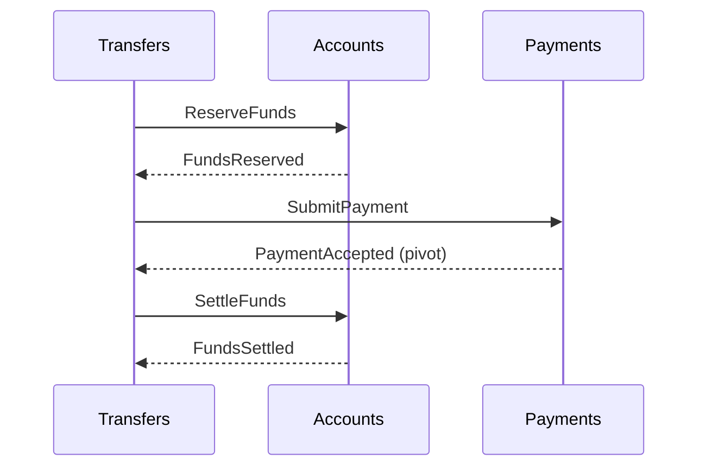
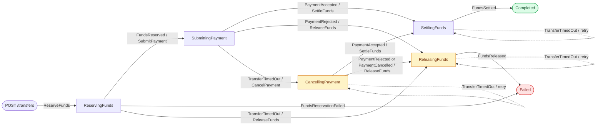

# Payment saga with Wolverine

A customer sends money from their account to a beneficiary. Three services:

- **Transfers** – HTTP API and saga orchestrator
- **Accounts** – reserves, settles and releases funds
- **Payments** – simulated bank that accepts, rejects or never answers

They talk over RabbitMQ. Each service has its own PostgreSQL database. [Wolverine](https://wolverinefx.net) handles
saga storage (EF Core), the durable inbox/outbox and the timeouts. The transitions use
[Stateless](https://github.com/dotnet-state-machine/stateless).



The reservation can be undone, so it runs first. Once Payments accepts, the money is gone, so from there the saga only
moves forward and settlement is retried until it succeeds. A payment timeout doesn't release funds straight away. The
bank may still have accepted, so Transfers sends `CancelPayment` and waits for the bank's answer. Payments keeps the
first decision it stores.

## Saga states



A reservation timeout goes to `ReleasingFunds` instead of failing straight away, because the reserve may have gone
through even though its reply was lost. A late or duplicate reply that no longer fits the current state is ignored.

## Run it

Needs Docker. The tests also need the .NET 10 SDK or newer.

```bash
docker compose up --build --wait
```

Balances and transfers live in named volumes, so they survive a restart. `docker compose down -v` resets them.

Or open `Payouts.slnx` in Visual Studio and start the `docker-compose` project.

Send a transfer from the seeded account `…0001` (EUR 1,000), then poll the `Location` it returns:

```powershell
$body = @{ id = [guid]::NewGuid(); sourceAccountId = '00000000-0000-0000-0000-000000000001'
           beneficiary = 'DEMOAPPROVE'; amount = 12.34; currency = 'EUR' } | ConvertTo-Json
$created = Invoke-WebRequest http://127.0.0.1:5180/transfers -Method Post -ContentType application/json -Body $body -UseBasicParsing
do { Start-Sleep 1; $t = Invoke-RestMethod "http://127.0.0.1:5180$($created.Headers.Location)" } while ($t.outcome -eq 'Pending')
$t
```

The ID is chosen by the caller and must not be all zeros. The amount must be in whole cents.

| Request | Result |
|---|---|
| `DEMOAPPROVE` | `Completed` with a `SIM-…` bank reference |
| `DEMOREJECT` | `Failed`, `BeneficiaryRejected`, funds released |
| `DEMOTIMEOUT` | `Failed`, `PaymentCancelled` after ~15 s (`SagaTimeouts:PaymentsReply`) |
| account `…0002` (EUR 50), amount 60 | `Failed`, `InsufficientFunds` |

Sending the same request again returns 200, even when both requests arrive at once. Reusing the same ID with a
different request returns 409. RabbitMQ
management is at http://127.0.0.1:15673 (`saga_demo` / `saga_demo_local`).

## Code

| Path | What |
|---|---|
| `src/Payouts.Shared` | Message records and the shared Wolverine/RabbitMQ setup (one queue per message type) |
| `src/Payouts.Transfers` | `Transfer.cs` (saga), `TransferStateMachine.cs`, `TransfersApp.cs` (API) |
| `src/Payouts.Accounts` | `FundsHandler.cs`: reserve, release and settle, all idempotent per transfer |
| `src/Payouts.Payments` | `PaymentHandler.cs`: write-once bank decision |
| `tests/Payouts.Tests` | Tests for the state machine, the participants and the full stack |

## Tests

```bash
dotnet test --solution Payouts.slnx
```

The journey and participant tests start PostgreSQL and RabbitMQ with Testcontainers, so they need Docker. The state
machine tests don't:

```bash
dotnet test --solution Payouts.slnx -- --filter-class Payouts.Tests.TransferTests
```

## Not covered

This is a demo. There's no auth, the schema is created with `EnsureCreated` rather than migrations, each service runs
as a single instance, and the bank is just a database table.

A message that still fails after three retries goes to its `*-error` queue, which you can see in the RabbitMQ UI. A
saga step that times out is resent forever; after five attempts each resend also logs a "stuck" error. There is no
alerting.
